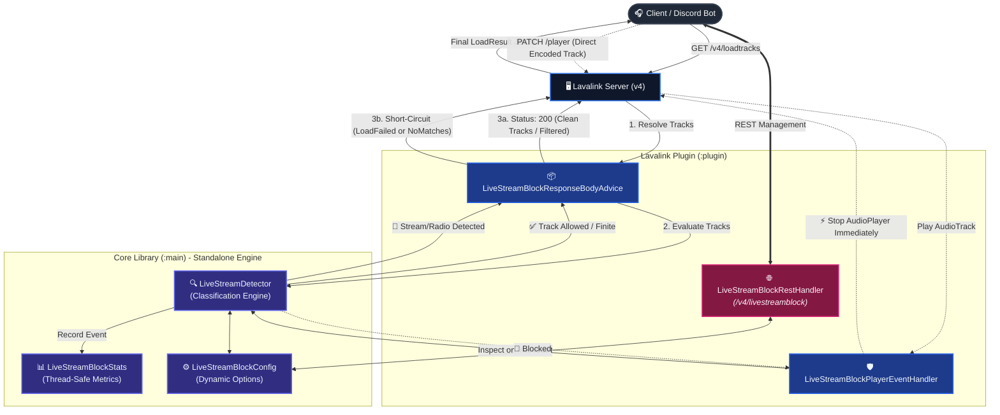

# 🚫 LiveStreamBlock - Lavalink v4 Plugin

**LiveStreamBlock** is a high-performance stream filtering and blocking plugin for **Lavalink v4**. It detects and intercepts live streams (YouTube Live, Twitch, Kick, TikTok, Vimeo) and online radio stations (Icecast, Shoutcast, HLS `.m3u8`, `.pls`, HTTP live broadcasts) at both track resolution time and playback execution time.

By evaluating tracks before they reach players, LiveStreamBlock prevents endless streams from congesting network bandwidth, exhausting server resources, and degrading node latency. It features granular toggle options, automatic playlist and search sanitization, player-level enforcement, and dynamic REST API management without requiring server restarts.

---

## 🚀 Architecture & Request Flow



### Why LiveStreamBlock Protects Your Node:
1. **Multi-Layer Interception:** 
   - **Layer 1 (REST Resolution):** Intercepts `/v4/loadtracks` responses. Blocked individual tracks are immediately short-circuited into friendly error responses (`LOAD_FAILED`) or empty matches (`NO_MATCHES`).
   - **Layer 2 (Player Safety Net):** If a bot circumvents `/v4/loadtracks` (e.g. by sending a raw serialized base64 track directly via `PATCH /v4/sessions/{sessionId}/players/{guildId}`), the `AudioPlayer` event listener halts the track at `onTrackStart`, terminating playback instantly.
2. **Intelligent Stream Classification:** Accurately distinguishes between regular finite media (e.g., standard YouTube songs or direct MP3 files) and continuous broadcasts (YouTube Livestreams, Twitch, Icecast/Shoutcast, HLS playlists).

---

## 🛡️ Detection & Classification Rules

The `LiveStreamDetector` evaluates track properties (`isStream`, `length`, `uri`, `sourceName`, `title`, `author`) through prioritized detection stages:

| Category / Stream Type | Example Query / URL | Identification Rule | Default Action |
| :--- | :--- | :--- | :--- |
| **YouTube Live Stream** | `https://www.youtube.com/watch?v=jfKfPfyJRdk` | `source == youtube && (isStream \|\| length == MAX)` | 🚫 **Blocked** (`BLOCKED_LIVESTREAM`) |
| **Twitch Broadcast** | `https://www.twitch.tv/streamer` | `source == twitch \|\| uri contains twitch.tv` | 🚫 **Blocked** (`BLOCKED_LIVESTREAM`) |
| **Video Live Platform** | `https://kick.com/...`, TikTok, Vimeo Live | Video platform domain & `isStream == true` | 🚫 **Blocked** (`BLOCKED_LIVESTREAM`) |
| **Icecast / Shoutcast Radio** | `http://stream.catradio.in.th:8000/live` | Radio ports (8000, 8080, 8443) or path markers & `isStream` | 🚫 **Blocked** (`BLOCKED_RADIO`) |
| **HLS / Playlist Radio** | `http://stream.domain.com/live.m3u8` | Extensions `.m3u8`, `.m3u`, `.pls`, `.asx` & indefinite | 🚫 **Blocked** (`BLOCKED_RADIO`) |
| **Continuous HTTP Audio** | `http://radio.example.com/stream` | `source == http && (isStream \|\| length == MAX)` | 🚫 **Blocked** (`BLOCKED_RADIO`) |
| **Standard YouTube Track** | `https://www.youtube.com/watch?v=dQw4w9WgXcQ` | `isStream == false` with finite length (e.g., 212s) | ✅ **Allowed** (`ALLOWED`) |
| **Direct MP3 / Audio File** | `https://cdn.example.com/audio/song.mp3` | Finite length, non-stream HTTP audio file | ✅ **Allowed** (`ALLOWED`) |
| **Whitelisted URL** | Configured in `allowed-urls` | Explicit whitelist override (regex / substring) | ✅ **Allowed** (`WHITELISTED`) |
| **Blacklisted URL / Keyword** | Configured in `blocked-urls` / `blocked-keywords` | Explicit pattern / keyword match | 🚫 **Blocked** (`BLOCKED_CUSTOM`) |

---

## 📦 Playlist & Search Sanitization

When users load playlists or perform searches containing live streams:

1. **Automatic Playlist Sanitization:**
   - Instead of rejecting an entire playlist because of a single live stream, LiveStreamBlock removes only the blocked live stream or radio tracks from the playlist, preserving all valid songs.
   - If **all** tracks in the playlist are live streams or radio stations, the playlist is rejected with a descriptive error or empty response according to the configured `action`.
2. **Search Query Filtering:**
   - Search results (`ytsearch:...`, `scsearch:...`) are sanitized to strip out live streams, ensuring users do not accidentally enqueue 24/7 radio loops or live broadcasts.
3. **Real-time Event Tracking:**
   - Every filtered track, blocked resolution, and player cutoff is recorded in the thread-safe `LiveStreamBlockStats` monitor.

---

## ⚙️ Configuration (`application.yml`)

Add the following configuration block to your Lavalink `application.yml`:

```yaml
lavalink:
  plugins:
    - dependency: "com.github.PeterGamez:LiveStreamBlock:1.0.0"
      repository: "https://jitpack.io" # Or place the .jar file directly into plugins/ directory

plugins:
  livestreamblock:
    enabled: true                 # Enable or disable plugin (default: true)

    rest-api:
      enabled: true               # Enable REST API endpoints (/v4/livestreamblock/...)
      password: ""                # Optional dedicated password (uses Lavalink server password if empty)

    block-live-streams: true      # Block video live streams (YouTube Live, Twitch, Kick, etc.)
    block-radio: true             # Block online radio (Icecast, Shoutcast, HLS .m3u8, .pls, HTTP radio)
    block-other-streams: true     # Block any other unidentified stream where isStream = true
    block-playback: true          # Safety net: stop playback at AudioPlayer level if stream starts

    filter-playlists: true        # Automatically strip live/radio tracks from playlists
    filter-search: true           # Automatically strip live/radio tracks from search results

    action: "EXCEPTION"           # Rejection mode: "EXCEPTION" (returns friendly error) or "EMPTY" (NoMatches)
    block-message: "Live streams and radio stations are blocked on this server."

    sources:
      youtube: true               # Enforce blocking on YouTube Live
      twitch: true                # Enforce blocking on Twitch
      http: true                  # Enforce blocking on HTTP Radio / Streams
      soundcloud: true            # Enforce blocking on SoundCloud Live

    # Optional: URLs or Regex patterns allowed even if they are live streams or radio
    allowed-urls:
      # - "https://www.youtube.com/watch?v=APPROVED_ID"
      # - "https://approved-radio-station.com/.*"

    # Optional: Additional URL or Regex patterns to block
    blocked-urls:
      # - ".*badradio.*"

    # Optional: Keywords in track title or author to block
    blocked-keywords:
      # - "24/7 radio"
      # - "live stream"
```

---

### 🔧 Configuration Options Breakdown

| Setting | Type | Default | Description |
| :--- | :--- | :--- | :--- |
| `enabled` | Boolean | `true` | Enables or disables the entire LiveStreamBlock plugin. |
| `rest-api.enabled` | Boolean | `true` | Enables `/v4/livestreamblock/...` REST endpoints. |
| `rest-api.password` | String | `""` | Optional password for REST API (`X-LiveStreamBlock-Password`). Defaults to server password. |
| `block-live-streams` | Boolean | `true` | Enables or disables blocking video live streams (YouTube Live, Twitch, Kick, Vimeo). |
| `block-radio` | Boolean | `true` | Enables or disables blocking online radio stations (Icecast, Shoutcast, .m3u8, .pls). |
| `block-other-streams` | Boolean | `true` | Blocks any other indefinite stream where `isStream == true`. |
| `block-playback` | Boolean | `true` | Player-level enforcement: immediately calls `audioPlayer.stopTrack()` if a stream starts. |
| `filter-playlists` | Boolean | `true` | Removes live/radio tracks from loaded playlists while preserving standard tracks. |
| `filter-search` | Boolean | `true` | Removes live/radio tracks from search query results (`ytsearch:`, `scsearch:`). |
| `action` | String | `"EXCEPTION"` | Rejection response: `"EXCEPTION"` (returns `LOAD_FAILED` with message) or `"EMPTY"` (`NO_MATCHES`). |
| `block-message` | String | `"..."` | Custom message returned to the client when a track is blocked. |
| `sources.youtube` | Boolean | `true` | Enables live stream detection for YouTube tracks. |
| `sources.twitch` | Boolean | `true` | Enables stream detection for Twitch. |
| `sources.http` | Boolean | `true` | Enables radio and continuous stream detection for HTTP/HTTPS sources. |
| `sources.soundcloud` | Boolean | `true` | Enables stream detection for SoundCloud live streams. |
| `allowed-urls` | List<String> | `[]` | Whitelist regex or URL substrings exempt from blocking. |
| `blocked-urls` | List<String> | `[]` | Blacklist regex or URL substrings always blocked. |
| `blocked-keywords` | List<String> | `[]` | Keywords in track title or author that trigger blocking. |

#### 💡 Deep Dive: How the Blocking Flags Differ

1. **Live Streams vs. Radio Stations (`block-live-streams` vs. `block-radio`)**
   - **`block-live-streams: true`, `block-radio: false`:** Blocks live video streaming platforms (YouTube Live, Twitch, Kick), while allowing online radio stations (Icecast, Shoutcast, FM web streams) to play normally.
   - **`block-live-streams: false`, `block-radio: true`:** Allows YouTube and Twitch live broadcasts, but blocks Internet radio stations.
   - **Both `true` (Default):** Disallows all continuous audio and video broadcasts.

2. **Action Modes (`action: "EXCEPTION"` vs. `"EMPTY"`)**
   - **`"EXCEPTION"` (Recommended):** Returns `loadType: "error"` with the configured `block-message`. The Discord bot can read this error and inform users why their requested stream cannot be played.
   - **`"EMPTY"`:** Returns `loadType: "empty"` (NoMatches), behaving identically to an invalid or deleted query.

---

## 📊 Monitoring & Admin REST Endpoints

LiveStreamBlock provides administrative, monitoring, and diagnostic endpoints under `/v4/livestreamblock/...`:

> [!NOTE]
> **Authentication:** Authenticate using the standard Lavalink password via `Authorization: <password>` or the dedicated `X-LiveStreamBlock-Password` header.

### 1. View Current Configuration
```http
GET /v4/livestreamblock/config
Authorization: password
```
**Example Response:**
```json
{
  "enabled": true,
  "blockLiveStreams": true,
  "blockRadio": true,
  "blockOtherStreams": true,
  "blockPlayback": true,
  "filterPlaylists": true,
  "filterSearch": true,
  "action": "EXCEPTION",
  "blockMessage": "Live streams and radio stations are blocked on this server.",
  "allowedUrls": [],
  "blockedUrls": [],
  "blockedKeywords": [],
  "sources": {
    "youtube": true,
    "twitch": true,
    "http": true,
    "soundcloud": true
  },
  "restApi": {
    "enabled": true,
    "hasPassword": false
  }
}
```

### 2. Update Configuration Dynamically (`POST` / `PATCH /v4/livestreamblock/config`)
Update toggles and options at runtime without restarting Lavalink.

> [!TIP]
> **Partial Updates Supported:** All fields are **completely optional**. Provide only the specific field(s) you wish to modify — omitted fields remain untouched.

#### Examples:

- **Allow radio temporarily while keeping live streams blocked:**
  ```http
  PATCH /v4/livestreamblock/config
  Authorization: password
  Content-Type: application/json

  {
    "blockRadio": false
  }
  ```

- **Switch action mode to EMPTY:**
  ```http
  PATCH /v4/livestreamblock/config
  Authorization: password
  Content-Type: application/json

  {
    "action": "EMPTY"
  }
  ```

- **Update multiple settings and message:**
  ```http
  POST /v4/livestreamblock/config
  Authorization: password
  Content-Type: application/json

  {
    "blockLiveStreams": true,
    "blockRadio": true,
    "blockMessage": "Streaming broadcasts are disabled by server policy."
  }
  ```

### 3. View Blocking Statistics
```http
GET /v4/livestreamblock/stats
Authorization: password
```
**Example Response:**
```json
{
  "tracksChecked": 184,
  "totalBlocked": 19,
  "liveStreamsBlocked": 12,
  "radioBlocked": 7,
  "otherStreamsBlocked": 0,
  "customBlocked": 0,
  "playlistsFiltered": 3,
  "tracksFilteredFromPlaylists": 5,
  "searchResultsFiltered": 6,
  "tracksFilteredFromSearch": 9,
  "playbackStopped": 2
}
```

### 4. Reset Statistics
```http
POST /v4/livestreamblock/stats/reset
Authorization: password
```

### 5. Test Track Identifier / URL (Diagnostic Test)
Test whether an identifier or URL will be blocked and inspect the exact reason:
```http
GET /v4/livestreamblock/test?identifier=https://www.youtube.com/watch?v=live123&source=youtube&isStream=true
Authorization: password
```
**Example Response:**
```json
{
  "blocked": true,
  "reason": "BLOCKED_LIVESTREAM",
  "reasonDescription": "Live stream blocked",
  "message": "Live streams and radio stations are blocked on this server.",
  "details": "YouTube Live Stream",
  "identifier": "https://www.youtube.com/watch?v=live123",
  "source": "youtube",
  "isStream": true
}
```

---

## 📄 License

This project is licensed under a **Custom License**:
- ✅ **Personal / Internal Use:** Free to run and use with Lavalink.
- 🍴 **Forking & Personal Modifications:** Permitted to fork and modify for personal use or PR contributions, provided the repository **remains an active, directly linked fork** (`forked from PeterGamez/LiveStreamBlock`) on GitHub at all times. Detaching or re-uploading as a standalone repository is strictly prohibited.
- 🚫 **No Commercial Use:** Selling, renting, or monetizing the software/code is strictly forbidden.
- 🚫 **No Redistribution:** Re-hosting, mirroring, or distributing binaries/code outside of official directly linked forks is not permitted.

For full terms and conditions, please see the [LICENSE](LICENSE) file.
